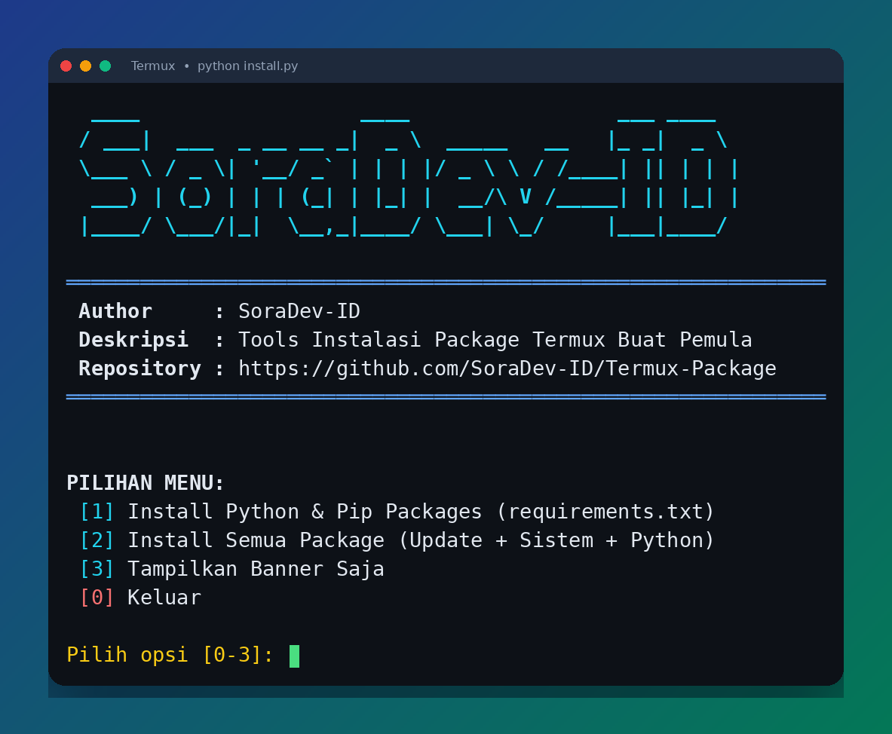

# 🚀 Termux-Package

[](https://www.python.org/)
[](https://termux.dev/)
[](LICENSE)
[](#)

> **TOOLS INSTALL PERINTAH TERMUX BUAT PEMULA**  
> Pasang semua package esensial dan modul Python di Termux Android hanya dengan sekali klik tanpa ribet mengetik perintah satu per satu!

---

## 📖 Apa Itu Package di Termux?

Bagi kamu yang baru pertama kali menggunakan **Termux**, aplikasi ini pada dasarnya adalah terminal Linux mini di perangkat Android.

Secara default, Termux hanya menyediakan perintah-perintah paling dasar. Agar kamu bisa mengunduh file (`curl`, `wget`), mengedit kode (`nano`), mengkloning repository (`git`), menjalankan script (`python`, `php`, `bash`), hingga melakukan riset jaringan (`nmap`), kamu perlu menginstal program-program tersebut yang disebut sebagai **package**.

Script **Termux-Package** ini dibuat untuk mempermudah kamu menyiapkan seluruh peralatan tempur dasar Termux secara otomatis, cepat, dan aman dari error!

---

## ✨ Fitur Utama

- ⚡ **Instalasi Batch & Paralel (v2)**: Package sistem dipasang berkelompok dalam satu panggilan `pkg` (bukan satu-satu), dan library Python dipasang paralel dengan beberapa worker — jauh lebih cepat dari versi sebelumnya.
- ⏭️ **Lewati yang Sudah Terpasang**: Status package dibaca sekali di awal; yang sudah ada di perangkat dilewati otomatis, jadi menjalankan ulang script ini terasa instan.
- ⌨️ **Mode CLI Non-Interaktif**: Selain menu, installer bisa dijalankan dengan flag (`--all`, `--system`, `--python`, `--dry-run`) untuk otomasi atau pemakaian cepat.
- 🛡️ **Fault-Tolerant (Tahan Error)**: Jika ada salah satu package yang gagal, instalasi tidak berhenti mendadak — kelompok yang gagal dipecah dan dicoba ulang satu per satu, lalu script lanjut sampai selesai.
- 📦 **Struktur Modular**: Daftar package sistem dan modul Python dipisahkan ke dalam file teks (`packages.txt` & `requirements.txt`), sehingga sangat mudah ditambah atau dikurangi tanpa perlu menyentuh kode program.
- 🎨 **Tampilan Visual Menarik**: Mendukung banner otomatis dengan `toilet` (jika terpasang), atau tampilan ASCII bawaan yang tetap rapi di Termux baru.
- 📊 **Laporan Ringkasan + Log**: Menampilkan rekap jumlah package yang terinstal, dilewati, dan gagal beserta durasinya; semua aktivitas juga dicatat ke `install.log`.

---

## 🖥️ Preview

<p align="center">
  
</p>
<p align="center">
  <em>Banner dan menu utama saat <code>python install.py</code> dijalankan di Termux.</em>
</p>

---

## 🛠️ Cara Instalasi & Menjalankan

Buka aplikasi **Termux** di HP Android kamu, lalu salin dan jalankan perintah berikut secara berurutan:

### 1. Update Termux & Pasang Git + Python
```bash
pkg update -y && pkg upgrade -y
pkg install git python -y
```

### 2. Kloning Repository
```bash
git clone https://github.com/SoraaaID/Termux-Package.git
```

### 3. Masuk ke Folder & Jalankan Script
```bash
cd Termux-Package
python install.py
```

---

## 📋 Pilihan Menu

Saat script dijalankan, kamu akan disajikan menu interaktif berikut:

| Opsi | Menu | Keterangan |
| :---: | :--- | :--- |
| **`[1]`** | **Install Python & Pip Packages** | Menginstal library Python dari `requirements.txt` secara paralel (seperti `requests`, `bs4`, `pyngrok`, dll). |
| **`[2]`** | **Install Semua Package** | Mode cepat: update index Termux, pasang seluruh package sistem (`packages.txt`) secara batch, lalu lanjut library Python. *(Direkomendasikan untuk pengguna baru)* |
| **`[3]`** | **Tampilkan Banner Saja** | Hanya mencetak banner SoraaaID ke layar terminal tanpa melakukan instalasi apa pun. |
| **`[4]`** | **Install Package Sistem Saja** | Hanya memasang package sistem dari `packages.txt` secara batch, tanpa library Python. |
| **`[0]`** | **Keluar** | Menutup program installer dengan rapi. |

### ⌨️ Mode CLI (Non-Interaktif)

Untuk pemakaian cepat atau otomasi, jalankan dengan flag — tanpa menu dan tanpa prompt:

```bash
python install.py --all              # update + sistem + python sekaligus
python install.py --system           # hanya package sistem
python install.py --python --jobs 6  # hanya pip, 6 worker paralel
python install.py --all --dry-run    # lihat rencana instalasi saja, tidak memasang apa pun
```

---

## 📁 Struktur Direktori

Repository ini disusun dengan struktur yang bersih, modular, dan mudah dikelola:

```text
Termux-Package/
├── install.py          # Script utama logika installer (Python 3)
├── packages.txt        # Daftar nama package sistem Termux (pkg/apt)
├── requirements.txt    # Daftar modul/library Python (pip)
├── LICENSE             # Lisensi open-source (MIT)
└── README.md           # Dokumentasi lengkap panduan pengguna
```

---

## 🧩 Cara Menambah Package Sendiri

Kamu bisa dengan bebas menambah atau menghapus tools sesuai kebutuhan:

- **Ingin menambah package Termux baru?**  
  Buka file `packages.txt`, lalu tambahkan nama packagenya di baris baru. Contoh:
  ```text
  ffmpeg
  neofetch
  ```
- **Ingin menambah library Python baru?**  
  Buka file `requirements.txt`, lalu tambahkan nama library pip di baris baru. Contoh:
  ```text
  rich
  flask
  ```

---

## 🤝 Cara Berkontribusi

Kontribusi selalu terbuka lebar untuk siapa saja!
1. Fork repository ini ke akun GitHub kamu.
2. Buat branch fitur baru (`git checkout -b fitur-keren`).
3. Commit perubahan kamu (`git commit -m 'Menambahkan package baru'`).
4. Push ke branch kamu (`git push origin fitur-keren`).
5. Buat **Pull Request** baru.

---

## 📄 Lisensi

Proyek ini didistribusikan di bawah lisensi resmi **MIT License**. Silakan gunakan, pelajari, dan modifikasi secara bebas untuk kebutuhan edukasi maupun personal. Lihat file [LICENSE](LICENSE) untuk detail selengkapnya.

---

<p align="center">
  Dibuat dengan ❤️ oleh <b><a href="https://github.com/SoraaaID">SoraaaID</a></b>
</p>
